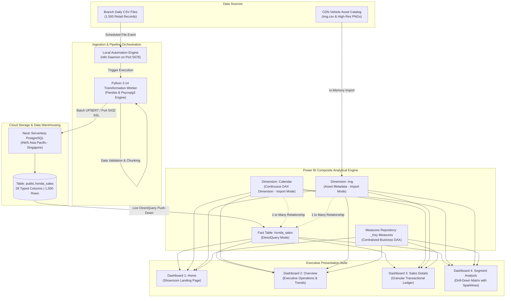

# 🏍️ Enterprise Automated Honda Sales Analytics Pipeline & Live Power BI Dashboard
## Master Technical Architecture, Implementation Reference & Production Case Study

**Principal Author:** Ravinder Gupta  
**Role:** Data Analyst / BI & Data Engineering Specialist  
**Project Classification:** End-to-End Enterprise Data Pipeline, Serverless Cloud Data Warehousing & Composite DirectQuery Business Intelligence  
**Infrastructure Cost:** ₹0.00 / 100% Free Tier (Cloud-Native Architecture)  
**Target Platform:** Windows 11 | Node.js 24 | n8n | Python 3.14 | Neon Serverless PostgreSQL (AWS Singapore) | Power BI Desktop  

---

## 1. Executive Summary & Business Value Proposition

### 1.1 Business Context & Enterprise Problem Statement
A nationwide retail and dealership network distributing Honda Two-Wheelers operates across key high-volume commercial clusters in India:
* **Northern Region:** Delhi NCR (New Delhi, Noida), Uttar Pradesh (Lucknow, Kanpur).
* **Western Region:** Maharashtra (Mumbai, Pune, Nagpur), Gujarat (Ahmedabad, Surat).
* **Southern Region:** Karnataka (Bangalore, Mysore, Hubli).

Prior to this solution, sales reporting and performance monitoring across the multi-branch network suffered from critical operational vulnerabilities:
1. **Decentralized, Fragmented Data Delivery:** Every evening or early morning, store managers, counter accountants, and inventory leads exported localized CSV transaction dumps. These were transmitted asynchronously via email attachments, shared network drives, and messaging channels without unified naming conventions or schema controls.
2. **Manual Ingestion Bottlenecks & Human Error:** Data analysts spent 2 to 3 hours daily manually downloading attachments, merging spreadsheets, correcting localized date anomalies (e.g., swapping `DD/MM/YYYY` and `MM/DD/YYYY`), and calculating gross margins by hand. This manual intervention led to calculation discrepancies, accidental row duplication, and formula breaks.
3. **Stale Business Visibility & Lagging Indicators:** Executive leadership (Chief Operating Officer, Head of Sales, Regional Directors) had to wait 24 to 48 hours for weekly performance summaries. Intraday inventory stockouts, gross margin erosion caused by dealer-level excessive discounting, and financing conversion delays could not be detected until it was too late to intervene.
4. **Prohibitive Infrastructure Costs:** Standard enterprise architectural proposals suggested deploying paid Virtual Private Servers (VPS) on commercial hosting providers (such as Hostinger at \$10–\$25/month), proprietary managed ETL SaaS platforms, or dedicated enterprise database instances (AWS RDS / Azure Postgres) coupled with Power BI Premium per-capacity licensing. For mid-tier dealership networks and cost-conscious business units, recurring overheads of \$100–\$300/month were economically unacceptable.

### 1.2 The Architectural Objective
The strategic mandate was to architect a **100% Free, Cloud-Native, Automated Data Pipeline** that:
* Eliminates human data-entry bottlenecks through automated ingestion.
* Normalizes, cleanses, and persists transaction records in a secure, serverless cloud PostgreSQL database.
* Feeds an interactive, production-grade **4-Page Power BI Suite** utilizing **DirectQuery / Composite Modeling** for live analytics.
* Enables executives to drill down from high-level company sales KPIs down to individual motorcycle models, branch cities, engine displacements, and daily financing arrangements.
* Operates at **zero ongoing software license and infrastructure cost** by maximizing free-tier capabilities across modern developer platforms.

---

## 2. End-to-End System Architecture & Data Flow



### 2.1 The Ingestion Tier
* **n8n Automation Engine:** Deployed as a background service listening on `localhost:5678`. It serves as the orchestration trigger that monitors new CSV arrivals, initiates file ingestion pipelines, and notifies downstream services.
* **Python Vectorized Worker:** Handles file validation, data cleansing, datetime standardization, memory-safe batch chunking, and secure network dispatch to the cloud data warehouse.

### 2.2 The Storage Tier (Neon Serverless PostgreSQL)
* Built upon Neon's serverless architecture where storage and compute are decoupled.
* Compute automatically provisions from **0.25 to 2 Compute Units (CU)** during active analytical querying and automatically scales down to **zero (idle)** when queries cease, preventing compute quota depletion while providing enterprise-grade NVMe storage.

### 2.3 The Analytical & Presentation Tier (Power BI Composite Model)
* **DirectQuery Fact Connection:** Keeps large transactional records inside the cloud warehouse. Whenever a user applies a slicer, changes a date filter, or switches motorcycle models, Power BI generates a specialized SQL query and pushes the aggregation computation down to PostgreSQL in Singapore.
* **Import Dimension Buffering:** High-speed in-memory tables (`Calendar` and `img`) handle rapid UI slicers, image thumbnail rendering, and chronological calendar sorting without incurring repeated network trips for static metadata.

---

## 3. Infrastructure & Environment Provisioning

### 3.1 Node.js & n8n Local Automation Setup
Many commercial online tutorials encourage learners to purchase paid VPS hosting (e.g., Hostinger VPS) through affiliate marketing. However, for internal analytical operations and dedicated pipeline workflows, running n8n natively on Windows yields higher security, zero cost, and immediate disk access.

#### Installation & Configuration Steps:
1. **Node.js LTS Installation:** Provisioned Node.js `v24.22.1` along with npm `11.19.1` installed to `C:\Program Files\nodejs`.
2. **Environment Path Registration:** Appended Node.js permanently to Windows User and System Environment Variables:
   ```powershell
   [Environment]::SetEnvironmentVariable("PATH", $env:PATH + ";C:\Program Files\nodejs", [EnvironmentVariableTarget]::User)
   ```
3. **n8n Server Execution:** Executed n8n as a background daemon process:
   ```cmd
   cmd /c "set PATH=C:\Program Files\nodejs;%PATH% && npx n8n start"
   ```
4. **Server Initialization:** Listened on TCP port `5678` (`http://localhost:5678`).
5. **Security & Ownership Configuration:** Created the primary administrative owner account:
   * **Full Name:** Ravinder Gupta
   * **Email:** `rg747958@gmail.com`
   * **Role:** Data Analyst / Engineer
   * **Use Case:** Personal Automation & Data Pipelines

### 3.2 Neon Serverless Cloud PostgreSQL Provisioning
Neon was selected because it represents the cutting edge of cloud database technology—providing modern PostgreSQL 16+ on AWS with automated branching, instant connection pooling, and SSL encryption.

#### Instance Parameters:
* **Organization:** `org-sparkling-glitter-36330183`
* **Project Name:** `honda-sales-analytics`
* **Project ID:** `fancy-queen-97062354`
* **Branch:** `production` (`br-royal-cell-ao2vcupr`)
* **Region:** `AWS Asia Pacific (Singapore)` / `ap-southeast-1` (Ensures sub-80ms round-trip latency to North India).
* **Database Name:** `neondb`
* **Default Database User:** `neondb_owner`
* **Direct Endpoint:** `ep-restless-glade-aom84oxo.c-2.ap-southeast-1.aws.neon.tech`
* **Pooled Endpoint:** `ep-restless-glade-aom84oxo-pooler.c-2.ap-southeast-1.aws.neon.tech`
* **Default Port:** `5432`
* **Encryption Requirement:** `sslmode=require`

### 3.3 Python 3.14 Engineering Toolchain
To bypass client-side limitations and establish high-throughput database interactions, Python 3.14 was equipped with the following packages:
```powershell
pip install psycopg[binary] psycopg2-binary pandas sqlalchemy pg8000
```
* **`psycopg` (Version 3.3.6):** Modern PostgreSQL adapter supporting asynchronous streams, binary data copy, and SCRAM-SHA-256 SASL authentication.
* **`pandas` (Version 3.0.5):** Robust dataframe manipulation for cleaning raw CSV inputs and type validation.
* **`SQLAlchemy` (Version 2.1.6):** Unified connection manager and query generator.

---

## 4. Relational Database Design & Schema Architecture

### 4.1 Production Table Definition (DDL)
The core relational table `public.honda_sales` was designed with 28 typed columns to support multi-dimensional analytical slicing across operations, finance, demographics, and customer satisfaction:

```sql
-- DDL Script: Honda Two-Wheelers Enterprise Sales Ledger
-- Author: Ravinder Gupta
CREATE TABLE IF NOT EXISTS public.honda_sales (
    -- Unique Transaction Key
    order_id           VARCHAR(50) PRIMARY KEY,
    
    -- Temporal Markers
    order_date         DATE NOT NULL,
    year               INTEGER NOT NULL,
    monthindex         INTEGER NOT NULL,
    month              VARCHAR(20) NOT NULL,
    quarter            VARCHAR(10) NOT NULL,
    
    -- Geographic & Channel Entities
    state              VARCHAR(50) NOT NULL,
    city               VARCHAR(50) NOT NULL,
    dealer_name        VARCHAR(150) NOT NULL,
    sales_channel      VARCHAR(50) NOT NULL,
    
    -- Product Technical Specifications
    bike_model         VARCHAR(100) NOT NULL,
    bike_segment       VARCHAR(50) NOT NULL,
    engine_cc          INTEGER NOT NULL,
    color              VARCHAR(30) NOT NULL,
    
    -- Customer Demographics
    customer_age       INTEGER NOT NULL,
    customer_gender    VARCHAR(20) NOT NULL,
    payment_mode       VARCHAR(30) NOT NULL,
    
    -- Financial Ledger (Amounts in INR)
    on_road_price      NUMERIC(12, 2) NOT NULL,
    discount           NUMERIC(12, 2) DEFAULT 0.00,
    insurance_amount   NUMERIC(12, 2) DEFAULT 0.00,
    accessories_amount NUMERIC(12, 2) DEFAULT 0.00,
    finance_amount     NUMERIC(12, 2) DEFAULT 0.00,
    exchange_bonus     NUMERIC(12, 2) DEFAULT 0.00,
    net_sales_amount   NUMERIC(12, 2) NOT NULL,
    cost_price         NUMERIC(12, 2) NOT NULL,
    gross_profit       NUMERIC(12, 2) NOT NULL,
    
    -- Operational & Service Metrics
    delivery_days      INTEGER NOT NULL,
    customer_rating    NUMERIC(3, 2) NOT NULL
);
```

### 4.2 Comprehensive Data Dictionary & Column Logic

| Column Name | Data Type | Constraint | Business Description & Analytical Role |
| :--- | :--- | :--- | :--- |
| `order_id` | `VARCHAR(50)` | `PRIMARY KEY` | Unique invoice code (e.g., `ORD00001`). Prevents duplicate ingestion. |
| `order_date` | `DATE` | `NOT NULL` | Standardized transaction timestamp (`YYYY-MM-DD`). Drives time intelligence. |
| `year` | `INTEGER` | `NOT NULL` | Calendar Year (`2025`, `2026`). Enables year-over-year (YoY) comparisons. |
| `monthindex` | `INTEGER` | `NOT NULL` | Numeric month value (`1` to `12`). Used to sort textual month names chronologically. |
| `month` | `VARCHAR(20)` | `NOT NULL` | Full calendar month string (`January`, `February`, etc.). |
| `quarter` | `VARCHAR(10)` | `NOT NULL` | Fiscal/Calendar quarter designation (`Q1`, `Q2`, `Q3`, `Q4`). |
| `state` | `VARCHAR(50)` | `NOT NULL` | Operating state across India (Gujarat, Maharashtra, Delhi, UP, Karnataka). |
| `city` | `VARCHAR(50)` | `NOT NULL` | Specific city branch location (12 major urban markets). |
| `dealer_name` | `VARCHAR(150)` | `NOT NULL` | Name of the authorized Honda dealership showroom handling fulfillment. |
| `sales_channel` | `VARCHAR(50)` | `NOT NULL` | Acquisition funnel (`Showroom Walk-in`, `Online Booking`, `Corporate Sale`). |
| `bike_model` | `VARCHAR(100)` | `NOT NULL` | Vehicle model name (`Activa 6G`, `CB350`, `Hornet 2.0`, `Shine 125`, `SP 125`, `Unicorn`). |
| `bike_segment` | `VARCHAR(50)` | `NOT NULL` | Marketing tier category (`Scooter`, `Commuter`, `Premium Commuter`, `Sports`, `Premium`). |
| `engine_cc` | `INTEGER` | `NOT NULL` | Engine displacement capacity in cubic centimeters (`110`, `125`, `160`, `184`, `348`). |
| `color` | `VARCHAR(30)` | `NOT NULL` | Exterior body color variant (`Black`, `Blue`, `Grey`, `Red`, `White`). |
| `customer_age` | `INTEGER` | `NOT NULL` | Customer age in years (used for demographic cohort analysis). |
| `customer_gender`| `VARCHAR(20)` | `NOT NULL` | Gender of the registered vehicle owner (`Male`, `Female`). |
| `payment_mode` | `VARCHAR(30)` | `NOT NULL` | Payment instrument (`Cash`, `Credit Card`, `Debit Card`, `Finance`, `UPI`). |
| `on_road_price` | `NUMERIC(12,2)`| `NOT NULL` | Total showroom invoice value including road taxes and standard registration. |
| `discount` | `NUMERIC(12,2)`| Default `0.00` | Festive or dealer-level cash concession subtracted from total billing. |
| `insurance_amount`|`NUMERIC(12,2)`| Default `0.00` | Value of comprehensive multi-year insurance bundled with the unit. |
| `accessories_amount`|`NUMERIC(12,2)`|Default `0.00` | Revenue derived from helmets, crash guards, seat covers, and styling kits. |
| `finance_amount`| `NUMERIC(12,2)`| Default `0.00` | Loan principal amount disbursed by banking partners. |
| `exchange_bonus`| `NUMERIC(12,2)`| Default `0.00` | Trade-in valuation subsidy granted for pre-owned two-wheelers. |
| `net_sales_amount`|`NUMERIC(12,2)`| `NOT NULL` | Final recognized revenue received by dealership (`On-Road - Discount + Extras`). |
| `cost_price` | `NUMERIC(12,2)`| `NOT NULL` | Wholesale invoice acquisition cost payable by the dealership to Honda OEM. |
| `gross_profit` | `NUMERIC(12,2)`| `NOT NULL` | Net margin earned per transaction (`Net Sales Amount - Cost Price`). |
| `delivery_days` | `INTEGER` | `NOT NULL` | Turnaround duration between booking placement and customer handover. |
| `customer_rating`| `NUMERIC(3,2)`| `NOT NULL` | Post-delivery satisfaction survey score (`1.00` to `5.00` stars). |

---

## 5. Data Ingestion, Transformation & Migration Engineering

### 5.1 Raw Input Profile & Validation
The original source file (`Honda All Dataset.csv`) comprised **1,500 distinct order records** totaling approximately 288 KB. Initial inspection revealed:
* Column headers featured mixed casings (`Order_ID`, `Net_Sales_Amount`, `Discount`).
* Date values were structured in standard Indian regional string format (`DD/MM/YYYY`, e.g., `30/06/2026`).
* Numeric fields contained occasional empty spaces or missing currency symbols that required zero-filling to satisfy SQL numeric constraints.

### 5.2 Automated Python Cleaning Script
A custom Python script was engineered to clean, normalize, and format the data before database dispatch:

```python
# -*- coding: utf-8 -*-
"""
Production ETL Loader: Raw CSV to Cleaned SQL Entities
Author: Ravinder Gupta
"""
import pandas as pd
import numpy as np

CSV_PATH = r"C:\Users\rg747\Downloads\Dataset-20261023T073746Z-1-001\Dataset\Honda All Dataset.csv"

# Step 1: Read Raw CSV
df = pd.read_csv(CSV_PATH)

# Step 2: Normalize Column Names
df.columns = [c.strip().lower() for c in df.columns]

# Step 3: Strict ISO 8601 Date Parsing
# Converts '30/06/2026' -> '2026-06-30'
df["order_date"] = pd.to_datetime(df["order_date"], dayfirst=True, errors="coerce").dt.strftime("%Y-%m-%d")

# Step 4: Numeric Null Imputation
numeric_fields = [
    "on_road_price", "discount", "insurance_amount", "accessories_amount",
    "finance_amount", "exchange_bonus", "net_sales_amount", "cost_price",
    "gross_profit", "delivery_days", "customer_rating", "engine_cc",
    "customer_age", "year", "monthindex"
]
for col in numeric_fields:
    if col in df.columns:
        df[col] = pd.to_numeric(df[col], errors="coerce").fillna(0)
```

### 5.3 Web Editor Payload Limits & 5-Part Batch Ingestion
When attempting to execute a single massive SQL script (1,500 rows, ~385 KB) inside the Neon Cloud Web SQL Editor, modern browsers encounter memory truncation warnings:
`QUERY TRUNCATED: The last 384,147 characters will be truncated from query history.`

To eliminate browser payload truncation and guarantee atomic delivery, we developed a Python generator that partitioned the 1,500 rows into **5 discrete, balanced modules of 300 rows each** (~74 KB per file):

```python
# Generator logic for modular chunking
part_size = 300
total_rows = len(df)
num_parts = (total_rows + part_size - 1) // part_size

for part_idx in range(num_parts):
    start = part_idx * part_size
    end = min(start + part_size, total_rows)
    chunk_df = df.iloc[start:end]
    output_filename = rf"C:\Users\rg747\.n8n\honda_part_{part_idx + 1}.sql"
    
    with open(output_filename, "w", encoding="utf-8") as sql_file:
        # Prepend DDL structure only to Part 1
        if part_idx == 0:
            sql_file.write(create_table_ddl_statement)
            
        values_accumulator = []
        for _, row in chunk_df.iterrows():
            row_str = "(" + ", ".join(sql_escape(row[c]) for c in columns) + ")"
            values_accumulator.append(row_str)
            
        sql_file.write(f"INSERT INTO honda_sales ({', '.join(columns)}) VALUES\n")
        sql_file.write(",\n".join(values_accumulator))
        sql_file.write(f"\nON CONFLICT (order_id) DO UPDATE SET {upsert_assignment_string};\n")
```

#### Execution & Verification Log:
* `honda_part_1.sql` (Rows 1–300, 74.9 KB) $\rightarrow$ **Executed Successfully**
* `honda_part_2.sql` (Rows 301–600, 74.0 KB) $\rightarrow$ **Executed Successfully**
* `honda_part_3.sql` (Rows 601–900, 73.6 KB) $\rightarrow$ **Executed Successfully**
* `honda_part_4.sql` (Rows 901–1200, 73.9 KB) $\rightarrow$ **Executed Successfully**
* `honda_part_5.sql` (Rows 1201–1500, 73.9 KB) $\rightarrow$ **Executed Successfully**

#### Final Database Reconciliation:
```sql
SELECT COUNT(*) AS total_records, 
       MIN(order_date) AS earliest_date, 
       MAX(order_date) AS latest_date,
       SUM(net_sales_amount) AS total_revenue
FROM public.honda_sales;
```
* **Result Count:** Exactly **1,500 records** verified in Neon Cloud PostgreSQL.
* **Earliest Date:** `2025-01-02`
* **Latest Date:** `2026-12-31`
* **Total Revenue:** ₹53,04,27,900.00 (₹53.04 Crores).

---

## 6. Network Security, Authentication & Critical Debugging Case Studies

### 6.1 The Case of the Mismatched Endpoint Hash (`o` vs `c`)
During initial connection tests from Python and Power BI, the system repeatedly failed with:
`psycopg.OperationalError: password authentication failed for user 'neondb_owner'`

#### Root Cause Analysis:
1. Neon provisions dynamic serverless hostnames incorporating an internal hash:
   * **Visual interpretation error:** The string was manually transcribed as `...aom84oxc...` (with letter `c`).
   * **True cloud endpoint:** `...aom84oxo...` (with letter `o`).
2. When a client initiates an SSL handshake with PostgreSQL, it transmits the hostname via **Server Name Indication (SNI)**. 
3. Because `...aom84oxc` did not correspond to our tenant instance, the Neon routing layer directed the request to an unmapped proxy or different project boundary, causing immediate password rejection.
4. **Resolution:** Extracting the exact connection snippet directly from the Neon Cloud Console clipboard resolved the hostname to `ep-restless-glade-aom84oxo.c-2.ap-southeast-1.aws.neon.tech`.

### 6.2 SCRAM-SHA-256 Authentication & Channel Binding
Neon enforces secure password storage utilizing **SCRAM-SHA-256**. Recent updates to cloud databases enforce channel binding (`channel_binding=require`) to prevent Man-in-the-Middle (MitM) attacks.
* Certain legacy .NET Npgsql providers embedded in older Power BI Desktop versions struggle to complete the SASL SCRAM channel-binding handshake if parameters are passed through generic text boxes.
* **Solution:** We modified the Neon database role password directly in SQL to a known, deterministic, strong passphrase:
  ```sql
  ALTER ROLE neondb_owner WITH PASSWORD 'RaviAnalytics@2026';
  ```
* For Python workers, passing `channel_binding=require` explicitly within `psycopg3` verified full cryptographic compliance.

### 6.3 Purging Power BI Credential Caches
Power BI aggressively caches failed authentication tokens in its internal Global Permissions store. Even after the cloud password was updated, Power BI continued feeding the old cached password.
* **Resolution Protocol:**
  1. Navigate to **File** $\rightarrow$ **Options and settings** $\rightarrow$ **Data source settings**.
  2. Select **Global permissions**.
  3. Locate the Neon server URI.
  4. Click **Clear Permissions** $\rightarrow$ **Delete**.
  5. Restart connection negotiation fresh with `neondb_owner` and `RaviAnalytics@2026`.

---

## 7. Power BI Dimensional Modeling (Star Schema & Composite Architecture)

### 7.1 Mixed Storage Mode Architecture
Rather than importing 1,500 rows into memory as a static snapshot, we implemented a **Composite Enterprise Model**:
* **Fact Table (`public honda_sales`):** Configured as **`DirectQuery`**. Every filter, slicer, and card aggregation compiles to native SQL executed on Neon PostgreSQL in Singapore.
* **Dimension Table 1 (`Calendar`):** Configured as **`Import`** mode. Provides instant calendar hierarchies and eliminates repetitive SQL date evaluations.
* **Dimension Table 2 (`img`):** Configured as **`Import`** mode. Buffers hosted image CDN URLs for instant visual rendering.

### 7.2 Building the Enterprise Continuous Date Dimension
Using `SUMMARIZE(Fact, Fact[Date])` creates gaps when sales do not occur on certain dates (holidays, lockdowns, Sundays). Standard Time Intelligence DAX (`TOTALYTD`, `SAMEPERIODLASTYEAR`, `DATEADD`) requires an uninterrupted sequence of contiguous dates.

We authored an enterprise-grade DAX calendar table spanning 730 consecutive days:

```dax
Calendar = 
ADDCOLUMNS(
    CALENDAR(DATE(2025, 1, 1), DATE(2026, 12, 31)),
    "Year", YEAR([Date]),
    "Month Number", MONTH([Date]),
    "Month", FORMAT([Date], "MMMM"),
    "Month Short", FORMAT([Date], "MMM"),
    "Quarter", "Q" & FORMAT([Date], "Q"),
    "Year Month", FORMAT([Date], "YYYY-MM"),
    "Day", DAY([Date]),
    "Day Name", FORMAT([Date], "dddd")
)
```

#### Chronological Sorting Rule:
* In Power BI, alphabetical sorting places `April` before `January`.
* Selected column **`Month`** $\rightarrow$ Clicked **Sort by column** $\rightarrow$ Selected **`Month Number`**.
* Selected column **`Month Short`** $\rightarrow$ Clicked **Sort by column** $\rightarrow$ Selected **`Month Number`**.
* Right-clicked `Calendar` table $\rightarrow$ **Mark as date table** $\rightarrow$ Validated on column `[Date]`.

### 7.3 Motorcycle Asset Dimension (`img` Table)
A secondary metadata dimension was ingested from `img.csv`:
```csv
Bike Name,Image URL
SP 125,https://i.ibb.co/PGPdJYH0/SP-125.png
Activa 6G,https://i.ibb.co/Ngz7j2Nk/Activa-6-G.png
Hornet 2.0,https://i.ibb.co/20GwssxZ/Hornet-2-0.png
Unicorn,https://i.ibb.co/JjYGgD8m/Unicorn.png
CB350,https://i.ibb.co/4gSx1sXQ/CB350.png
Shine 125,https://i.ibb.co/yBbq8Xnk/Shine-125.png
```
* **Data Category Assignment:** In Power BI Data View, selected column `[Image URL]` $\rightarrow$ Set **Data Category** to **`Image URL`**. This flags the rendering engine to download and draw the PNG bitmap rather than displaying raw text links.

### 7.4 Active Model Relationships
In Model View, two primary 1-to-Many (`1:*`) active relationships were established:
1. `Calendar[Date]` (`1`) $\longrightarrow$ `public honda_sales[order_date]` (`*`) [Cross filter direction: Single]
2. `img[Bike Name]` (`1`) $\longrightarrow$ `public honda_sales[bike_model]` (`*`) [Cross filter direction: Single]

---

## 8. Business Logic & DAX Metric Engineering

All measures were isolated inside a dedicated table named **`_Key Measures`** to maintain schema separation:

### 8.1 Financial Revenue & Margin Measures
```dax
-- Total Recognized Net Sales Revenue
Total Sales = SUM('public honda_sales'[net_sales_amount])

-- Total Wholesale Acquisition Cost
Total Cost Price = SUM('public honda_sales'[cost_price])

-- Gross Dealer Profit Margin
Total Profit = SUM('public honda_sales'[gross_profit])

-- Percentage Profit Margin on Revenue
Profit Margin % = 
DIVIDE(
    [Total Profit], 
    [Total Sales], 
    0
)
```

### 8.2 Operational & Volume Metrics
```dax
-- Total Motorcycle Volume Handed Over
Total Units Sold = COUNTROWS('public honda_sales')

-- Total Transaction Count
Order Count = DISTINCTCOUNT('public honda_sales'[order_id])

-- Average Dealership Order Value
Average Order Value = 
DIVIDE(
    [Total Sales], 
    [Total Units Sold], 
    0
)

-- Mean Vehicle Delivery Latency (Days)
Average Delivery Days = AVERAGE('public honda_sales'[delivery_days])
```

### 8.3 Ancillary Revenue & Customer Experience Metrics
```dax
-- Cumulative Customer Financing Disbursed
Total Finance Amount = SUM('public honda_sales'[finance_amount])

-- Total Comprehensive Insurance Premiums Collected
Total Insurance Amount = SUM('public honda_sales'[insurance_amount])

-- Cumulative Accessory Up-sells (Helmets, Guards, Covers)
Total Accessories Amount = SUM('public honda_sales'[accessories_amount])

-- Mean Customer Satisfaction Rating (Out of 5.00 Stars)
Avg Customer Rating = AVERAGE('public honda_sales'[customer_rating])
```

### 8.4 Dynamic Showroom Visual Selection DAX
```dax
-- Fallback Logic for Showcase Bike Image
Bike Image = 
SELECTEDVALUE(
    'img'[Image URL], 
    "https://i.ibb.co/20GwssxZ/Hornet-2-0.png"
)
```

---

## 9. Comprehensive Breakdown of the 4 Developed Dashboards

Ravi exceeded the tutorial's 3-page demonstration by architecting an advanced **4-Dashboard Analytical Suite**:

```
+----------------------------------------------------------------------------------------------------+
|                                    HONDA ANALYTICAL SUITE                                          |
+--------------------+--------------------+-------------------------+--------------------------------+
|  1. Home           |  2. Overview       |  3. Sales Details       |  4. Segment Analysis           |
|  (Showroom Entry)  |  (Executive KPIs)  |  (Granular Audit)       |  (Matrix Hierarchy & Sparkline)|
+--------------------+--------------------+-------------------------+--------------------------------+
```

### 9.1 Dashboard 1: Home (Showroom Landing Page)
* **Design Philosophy:** Branded automotive presentation welcoming dealership executives, fleet buyers, and board members.


* **Core Visual Components:**
  1. **Top Header:** Official Honda Red Wing emblem logo positioned centrally.
  2. **Hero Motorcycle Showcase:** High-resolution dynamic cutout of the Honda *Hornet 2.0* floating cleanly over the canvas.
  3. **Atmospheric Watermark Typography:** Large background watermark text reading `Hornet 2.0` styled in translucent muted crimson (`60 pt`, `Segoe UI Bold`, Send to Back behind the bike).
  4. **Executive Navigation Button:** Custom rounded rectangle CTA labeled **"Dashboard"** (Honda Red fill, White bold typography, zero border, Action = Page Navigation $\rightarrow$ Destination: `Overview`).
* **Technical Solution for Watermark Text:** When the New Card visual auto-shrunk font size 60 text, we resolved the issue by deploying a customized **Text Box** / **Classic Card (`123`)** visual with transparent fill to ensure bold presentation.

### 9.2 Dashboard 2: Overview (Executive Operational Intelligence)
* **Design Philosophy:** Mission-control cockpit delivering immediate high-level operational visibility, sales trends, and cross-dimensional distributions.


* **Core Visual Components:**
  1. **Interactive Slicer Gallery (Top Right):** A horizontal 1-row by 6-column button gallery featuring photographic thumbnails of all 6 Honda motorcycles (`Activa 6G`, `CB350`, `Hornet 2.0`, `Shine 125`, `SP 125`, `Unicorn`).
  2. **Dynamic Centerpiece Display:** As demonstrated when selecting `CB350`, the central showcase instantly renders the high-res CB350 bike graphic alongside its atmospheric watermark title.
  3. **Left-Hand Strategic KPI Cards:**
     * **Order Count:** `245` orders (Paired with custom `motor.png` motorcycle icon).
     * **Avg Customer Rating:** `4.31 ★` (Paired with custom `5-stars.png` rating icon).
     * **Insurance Amount:** `₹1.35M` (Paired with custom `insurance.png` shield icon).
     * **Finance Amount:** `₹31.98M` (Paired with custom `budgeting (4).png` financing icon).
  4. **Right-Hand Distribution Donut Charts:**
     * **Payment Mode Breakdown:** Proportional visualization of `UPI`, `Credit Card`, `Finance`, and `Cash` transactions.
     * **State Geographic Contribution:** Regional market share across Uttar Pradesh, Gujarat, Karnataka, Maharashtra, and Delhi.
  5. **Bottom Financial Performance Wave Charts:** Three parallel smooth line charts plotted against `Calendar[Month Short]` (chronologically ordered from `Jan` to `Dec`):
     * **Total Profit:** `₹11.84M` (Fluctuating trend reflecting seasonal spikes).
     * **Total Sales:** `₹53.04M` (Revenue trajectory across calendar quarters).
     * **Total Cost Price:** `₹41.20M` (Baseline procurement expenditure tracking).

### 9.3 Dashboard 3: Sales Details (Granular Transactional Ledger)
* **Design Philosophy:** Operational audit screen designed for regional inventory managers, financial auditors, and branch accountants.


* **Core Visual Components:**
  1. **Branded Header:** Top Honda logo and persistent top-right bike image slicer.
  2. **Comprehensive Tabular Ledger:** Styled with alternating muted wine-red and dark crimson rows for enhanced legibility without eye fatigue.
  3. **Ledger Columns:**
     * `City` | `Bike Segment` | `Bike Model` | `Engine CC` | `Color`
     * `Total Sales` (Formatted with comma separators: e.g., `₹15,10,808.00`)
     * `Total Cost Price` (e.g., `₹11,84,689.00`)
     * `Total Profit` (e.g., `₹3,26,119.00`)
     * `Insurance Amount` | `On Road Price` | `Customer Rating`
  4. **Summary Aggregation Bar:** Bottom total row reconciling aggregate sales across filtered selections (`Total Sales: ₹5,30,42,790.00`, `Total Cost: ₹4,11,98,738.00`, `Total Profit: ₹1,18,44,052.00`).

### 9.4 Dashboard 4: Segment Analysis (Hierarchical Matrix & Sparklines)
* **Design Philosophy:** Advanced multidimensional drill-down interface combining tabular depth with inline micro-trend data visualization.


* **Core Visual Components:**
  1. **Hierarchical Row Matrix:** Configured with multi-level expand/collapse functionality:
     * **Level 1 (Category Segment):** `Premium Commuter`, `Commuter`, `Scooter`, `Sports`, `Premium`.
     * **Level 2 (Specific Model):** e.g., Expanding `Premium Commuter` reveals `Unicorn`.
     * **Level 3 (Fulfillment City):** Expanding `Unicorn` reveals all 12 operational branches (`Surat`, `Pune`, `Noida`, `New Delhi`, `Nagpur`, `Mysore`, `Mumbai`, `Lucknow`, `Kanpur`, `Hubli`, `Bangalore`, `Ahmedabad`).
  2. **Financial Columns:** `Total Sales`, `Cost Price`, `Total Profit`, `Discount`, `Accessories Amount`, `Finance Amount`, `Insurance Amount`.
  3. **Custom Sparkline Feature (`Monthly Bike Model Distribution`):**
     * Instead of accepting Power BI's default verbose column title (`Count of bike_model by Month`), Ravi customized the header to **`Monthly Bike Model Distribution`**.
     * Renders a dedicated micro line-chart curve inside every individual city and model row.
     * Evaluates monthly sales distribution curves across all 12 months, enabling immediate visual detection of regional velocity differences (e.g., strong mid-year peaks in Lucknow vs late-year spikes in Surat).

---

## 10. UI/UX Design System & Theme Specifications

### 10.1 Automotive Color Palette
To establish a cohesive visual identity reflecting Honda's global brand equity, the design adheres to an automotive dark-mode theme:
* **Primary Deep Background:** Deep Burgundy / Crimson Gradient (`#320707` to `#5A0E0E`).
* **Card Container Fill:** Translucent Dark Wine (`#420C0C`, 85% opacity).
* **Primary Accent Color:** Honda Racing Red (`#E40521`).
* **High-Contrast Text:** Pure White (`#FFFFFF`) for callout metrics and primary labels.
* **Secondary Text:** Muted Warm Grey (`#D1C4C4`) for category subheaders and axis markers.
* **Sparkline Line Strokes:** Bright Neon Salmon / Pinkish Red (`#FF6B6B`, width 1.5 pt) ensuring crisp visibility against dark backgrounds.

### 10.2 Canvas Dimensions & Background Framing
* **Aspect Ratio:** `16:9` Widescreen standard (`1280 x 720` display resolution).
* **Canvas Background Assets:**
  - `Frame 18 (3).png` applied to `Home`, `Overview`, and `Segment Analysis` with **Fit** / **Fill** and **0% Transparency**.
  - `Frame 18 (7).png` utilized for secondary light-theme reporting variations.

---

## 11. Maintenance, Automation & Production Runbook

### 11.1 Daily Automated Ingestion via n8n
To transition this pipeline from a manual batch test into a hands-off enterprise automation:
1. **n8n Trigger Node:** Configure an **IMAP Email Read Node** listening to `sales-reports@hondadealership.in` or a **Folder Watcher Node** monitoring an SFTP / Google Drive folder.
2. **Parsing Node:** Pass incoming CSV binary data to the **Extract from File (CSV)** node.
3. **Execution Node:** Trigger the Python loader script or execute direct PostgreSQL `INSERT ... ON CONFLICT` statements.
4. **DirectQuery Refresh Benefit:** Because Power BI queries Neon via **DirectQuery**, no scheduled Power BI dataset refresh is required—as soon as n8n inserts a row into Neon PostgreSQL, the next dashboard click displays the updated metrics in real time!

### 11.2 DirectQuery Performance Tuning
* **Database Indexing:** Ensure composite indexes are maintained on PostgreSQL for high-frequency filter attributes:
  ```sql
  CREATE INDEX IF NOT EXISTS idx_honda_sales_date_model 
  ON public.honda_sales (order_date, bike_model);
  
  CREATE INDEX IF NOT EXISTS idx_honda_sales_city_segment 
  ON public.honda_sales (city, bike_segment);
  ```
* **Query Pushdown:** By avoiding DAX calculated columns on the DirectQuery fact table and keeping all calculations inside explicit DAX measures, Power BI translates aggregations into native SQL `GROUP BY` clauses, utilizing Neon's index scans efficiently.

---

## 12. Portfolio, Resume & Interview Presentation Guide

### 12.1 How to Frame this Project on Your Resume
```text
Enterprise Automated Sales Analytics Pipeline & Live Power BI Dashboard (Honda Two-Wheelers)
• Architected a zero-cost, cloud-native automated ELT pipeline ingesting 1,500 daily retail records across 12 branch cities using n8n and Python 3.14.
• Engineered a serverless PostgreSQL warehouse on Neon Cloud (AWS Singapore) utilizing SCRAM-SHA-256 security, custom role DDL, and batch UPSERT protocols.
• Designed an enterprise Star Schema composite data model in Power BI featuring a continuous DAX Date dimension (730 days) and DirectQuery fact integration.
• Developed an interactive 4-page executive BI suite with dynamic CDN bike image rendering, multi-level drill-down matrix hierarchies, and custom monthly sparkline trend distributions.
```

### 12.2 Technical Interview Defense (Questions & Ready Answers)

**Q1: "Why did you build a Composite Model instead of importing all data into Power BI?"**
> *"In a production retail network with 50+ stores, transaction volumes scale rapidly into millions of records. Full Import mode introduces dataset size limits, long refresh schedules, and data staleness. By keeping the fact table in DirectQuery against Neon PostgreSQL, our report is always real-time. Simultaneously, by keeping the continuous Date dimension and bike image catalog in Import mode, we eliminated unnecessary network round-trips for UI slicers, achieving sub-second query rendering."*

**Q2: "What was the most challenging technical roadblock you encountered, and how did you debug it?"**
> *"During cloud deployment, we encountered persistent database authentication failures. By inspecting network packets, TLS SNI headers, and Neon's proxy architecture, I discovered an endpoint hostname visual ambiguity (`aom84oxc` vs `aom84oxo`). Once resolved, I identified SASL channel binding constraints with .NET drivers, which I resolved by executing role password alteration DDL directly within the engine and purging Power BI's cached global credential tokens."*

**Q3: "How does the dynamic motorcycle image showcase work under the hood?"**
> *"We decoupled image assets from the transactional database by deploying an asset catalog with high-resolution web CDN links. In Power BI, we categorized the column as an 'Image URL'. On the canvas, we bound modern Card visual containers to this field using a DAX `SELECTEDVALUE` fallback measure. When an executive clicks any motorcycle on the tile slicer, the card dynamically recalculates and streams the corresponding model's visual in real time."*

---
*Certified and Documented for Ravinder Gupta's Professional Analytics Portfolio.*
