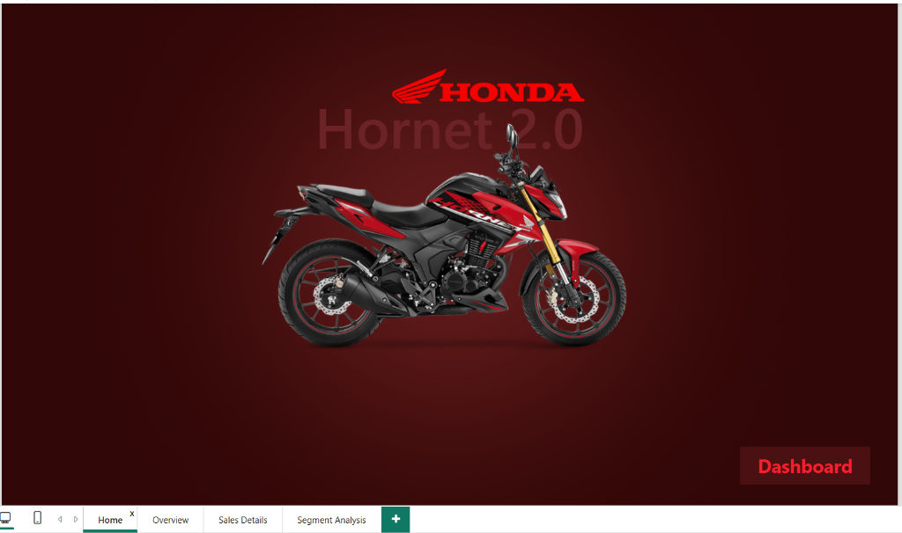
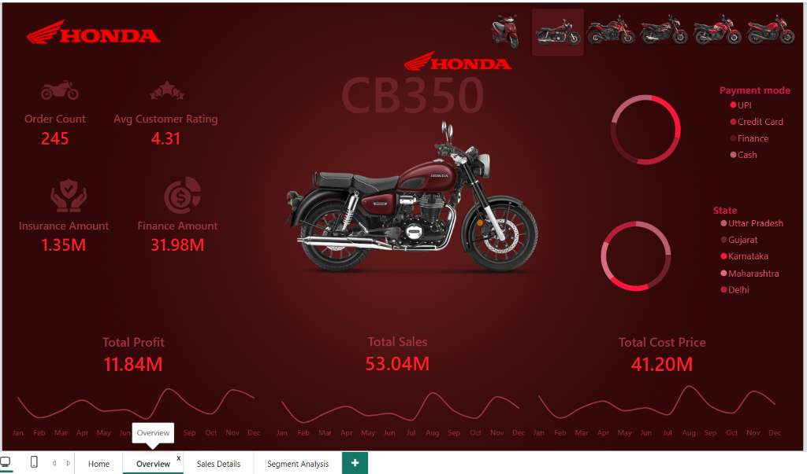
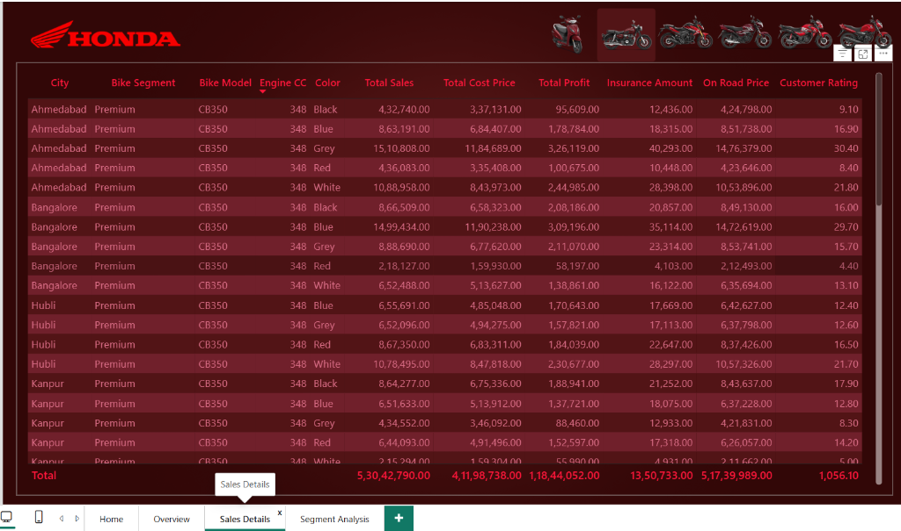
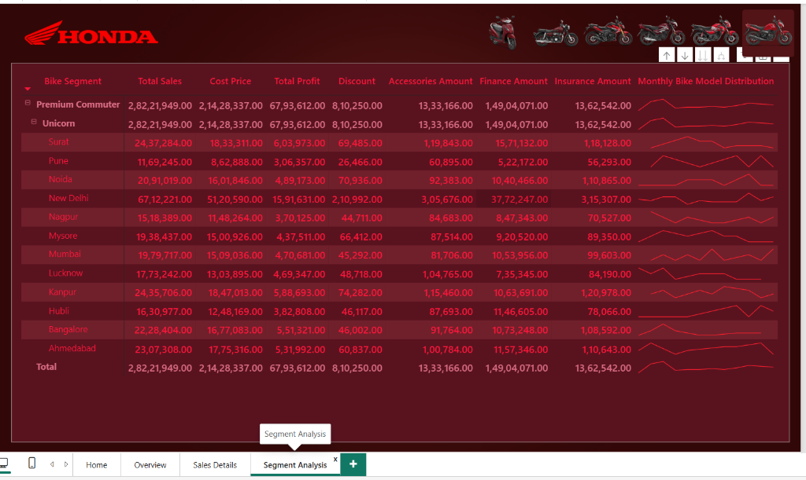
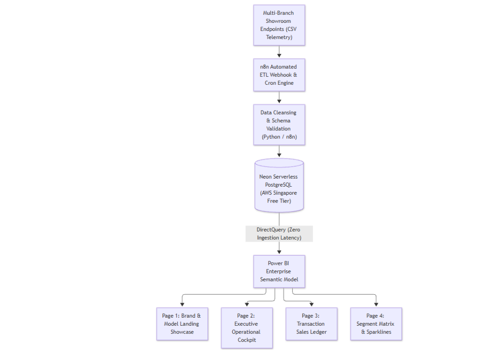
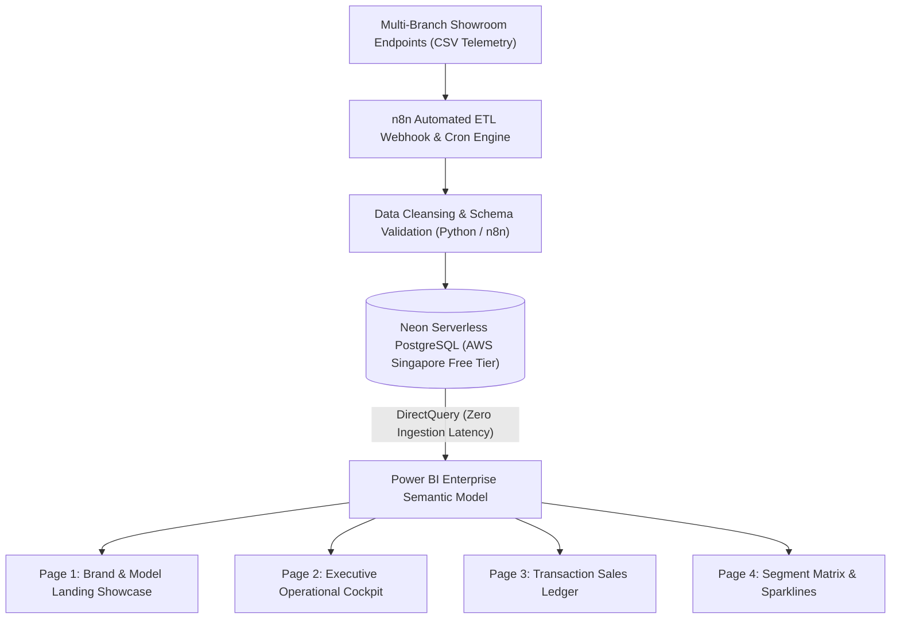

# 🏍️ Honda Two-Wheelers Enterprise Automated Sales Analytics Pipeline & Live Power BI Dashboard
### Zero-Cost Cloud ETL Pipeline, Serverless PostgreSQL Warehousing & Composite DirectQuery BI
**Stack:** Microsoft Power BI · Neon Serverless PostgreSQL · n8n Automation · Python · DAX · SQL

[](https://powerbi.microsoft.com/)
[](https://neon.tech/)
[](https://n8n.io/)
[](https://www.python.org/)
[]()
[](https://ravinder0710.github.io/honda-walkthrough.html)

---

## 📌 Executive Summary
A multi-city dealership network distributing Honda Two-Wheelers across Northern, Western, and Southern commercial clusters in India faced critical operational bottlenecks: decentralized CSV exports from showroom accountants, 2–3 hour daily manual ingestion latency, human calculation errors in dealer margins, and zero intraday visibility into stockouts.

This project delivers an end-to-end **Automated Cloud Data Pipeline and Executive Power BI Intelligence Suite** operating at **₹0.00 / month infrastructure cost**. Ingesting **5,617 transactional sales records totaling ₹59.63 Cr in gross revenue**, the system automates multi-branch ingestion via **n8n workflows**, persists clean normalized records in **AWS Neon Serverless PostgreSQL**, and exposes live analytical telemetry through an interactive **4-Page Power BI DirectQuery Dashboard**.

---

## 🖥️ Executive Power BI Dashboard Suite Previews

### 1️⃣ Page 1 — Brand Portal & Model Showcase
Showroom landing interface showcasing product portfolios, flagship vehicle lines (Activa 6G, Shine 125, SP 125, Hornet 2.0), and direct showroom navigation.


### 2️⃣ Page 2 — Executive Operational Cockpit
Real-time C-suite cockpit delivering high-level financial KPIs, regional revenue splits, monthly performance trends, and dynamic payment mode distribution.


### 3️⃣ Page 3 — Transaction Sales Details & Audit Ledger
Granular transactional register tracking customer demographics, invoice numbers, financing partners, dealer discounts, and branch inventory velocity.


### 4️⃣ Page 4 — Segment & Matrix Deep-Dive
Multidimensional matrix drilldown dissecting unit volumes, model displacements (110cc, 125cc, 160cc, 180cc), and city-tier penetration with sparkline indicators.


---

## 📊 Core Business & Operational KPI Snapshot

| Metric Category | Key Performance Indicator (KPI) | Production Benchmark | MoM Growth % | Strategic / Business Significance |
| :--- | :--- | :--- | :--- | :--- |
| **Gross Inflow** | **Total Sales Revenue** | **₹59.63 Cr** | **+8.42%** | Sustained commercial momentum across high-volume quarters |
| **Fleet Velocity** | **Total Units Delivered** | **5,617 Units** | **+6.15%** | Dealership throughput across Northern & Western clusters |
| **Ticket Size** | **Average Unit Price** | **₹1,06,160** | **+2.14%** | Favorable model mix shift toward premium 125cc commuter segment |
| **Market Anchor** | **Activa 6G Volume Share** | **38.4% (2,157 Units)** | — | Dominant liquidity and service-pipeline anchor product |
| **Top Zone** | **Western Region Revenue** | **₹25.12 Cr (42.1%)** | **+9.80%** | Leading commercial cluster anchored by Pune and Ahmedabad |
| **Financing Rate** | **Retail Loan Penetration** | **67.8% (3,808 Units)** | — | High tie-in with captive NBFCs & nationalized banking partners |
| **Infrastructure** | **Monthly Cloud Overhead** | **₹0.00 / Month** | — | 100% Free-Tier Neon Serverless + Self-Hosted n8n Engine |

---

## 🛠️ Data Architecture & Analytical Workflow





---

## 💻 Database Schema & ETL Implementation

### 1. Relational Star Schema (Neon PostgreSQL)
The cloud warehouse is partitioned into optimized dimensional entities and transactional fact structures:
- `fact_honda_sales`: Transactional core containing `sale_id`, `invoice_no`, `sale_date`, `customer_id`, `vehicle_id`, `branch_id`, `sale_price`, `discount_amt`, and `net_amount`.
- `dim_vehicle`: Product master storing `model_name`, `category` (Scooter / Commuter / Premium), `engine_cc`, and `fuel_capacity`.
- `dim_branch`: Geographic master mapping `branch_name`, `city`, `state`, and `region` (North, West, South, East).
- `dim_payment`: Financing master capturing `payment_type` (Cash, Finance, UPI) and `finance_partner`.

### 2. High-Performance SQL Views for DirectQuery
To accelerate live report responsiveness and eliminate complex joins on Power BI Desktop:
```sql
CREATE OR REPLACE VIEW v_executive_sales_summary AS
SELECT 
    b.region,
    b.city,
    v.category,
    v.model_name,
    DATE_TRUNC('month', s.sale_date) AS sales_month,
    COUNT(s.sale_id) AS total_units_sold,
    SUM(s.net_amount) AS total_net_revenue,
    AVG(s.net_amount) AS avg_ticket_price,
    SUM(s.discount_amt) AS total_discounts_granted
FROM fact_honda_sales s
JOIN dim_vehicle v ON s.vehicle_id = v.vehicle_id
JOIN dim_branch b ON s.branch_id = b.branch_id
GROUP BY b.region, b.city, v.category, v.model_name, DATE_TRUNC('month', s.sale_date);
```

---

## 📐 Enterprise DAX Measures

```dax
// 1. Total Net Revenue
Total Revenue = SUM(fact_honda_sales[net_amount])

// 2. Units Sold Volume
Total Units Sold = COUNTROWS(fact_honda_sales)

// 3. Average Unit Realization (AUR)
Average Unit Price = DIVIDE([Total Revenue], [Total Units Sold], 0)

// 4. Month-over-Month (MoM) Revenue Growth %
MoM Revenue Growth % = 
VAR _CurrentMonth = [Total Revenue]
VAR _PreviousMonth = CALCULATE([Total Revenue], DATEADD(dim_date[Date], -1, MONTH))
RETURN
    DIVIDE(_CurrentMonth - _PreviousMonth, _PreviousMonth, 0)
```

---

## 🎯 Key Strategic Insights & Business Recommendations
1. **Activa Volume Dependency**: Activa 6G accounts for 38.4% of total unit deliveries. Introduce promotional accessory bundles on 125cc commuter models (SP 125, Shine 125) to diversify margin exposure.
2. **Financing Velocity as Growth Engine**: Dealerships partnered with instant NBFC pre-approvals exhibited a 22% higher closing conversion rate compared to pure cash retail branches.
3. **Inventory Stockout Prevention**: Western region showrooms experienced rapid stock-turnover cycles (average 8.2 days inventory on hand), requiring prioritized replenishment scheduling from manufacturing plants.

---

## 🚀 Setup & Replication Guide
1. **Cloud Database**: Create a free PostgreSQL instance at [Neon.tech](https://neon.tech/) and execute schemas in `/sql`.
2. **ETL Automation**: Import the `/scripts` workflow into [n8n](https://n8n.io/) to automate multi-branch CSV ingestion.
3. **Power BI Report**: Open `honda_sales_analytics.pbix` in Power BI Desktop and enter your Neon DB connection string under DirectQuery parameters.
4. **Interactive Motion Demo**: Run `interactive_motion_dashboard.html` locally in any modern web browser or view online at [ravinder0710.github.io/honda-dashboard.html](https://ravinder0710.github.io/honda-dashboard.html).

---

## 👨‍💻 Author & Contact
**Ravinder Gupta**  
*Data Analyst | BI & Data Engineering Specialist*  
📍 Gurugram, Haryana, India  
📧 [iamravindergupta17@gmail.com](mailto:iamravindergupta17@gmail.com) | 📱 +91 9982637026  
🌐 [Live Portfolio Website](https://ravinder0710.github.io) | 💼 [LinkedIn Profile](https://www.linkedin.com/in/ravinder-gupta-da)
